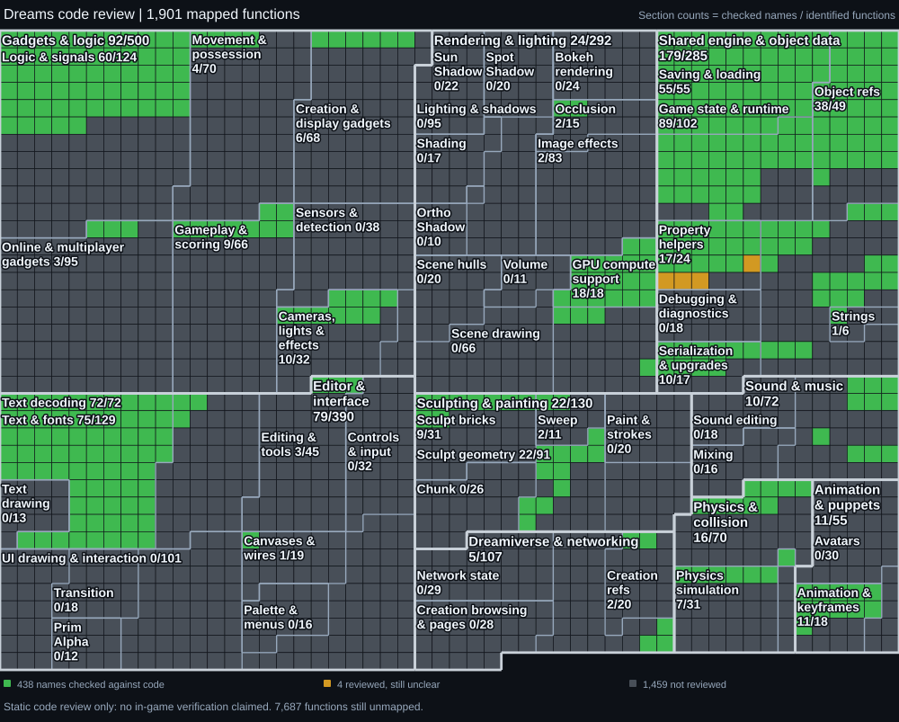

# DREAMS
### Reverse engineering progress

Function discovery · Decompilation · Verified naming

[Progress log](PROGRESS.md) · [Function review](analysis/function-review.json) · [Status data](analysis/status.json)

## Status

Each square represents **one of the 9,551 functions currently discovered**, ordered by address. The grids show a measured snapshot of this analysis, not a percentage of the entire game recovered. Cached pseudocode and verified understanding are counted separately.

## Latest checkpoint

- **Two names verified:** `VisitCalculatorProperties` and `VisitFogProperties`, saved and checked after reopening. Six other reviewed functions remain unresolved.
- **PS4 calling conventions:** 9,486 direct assignments plus 19 inherited thunk conventions, validated on a copy before updating the working project. Existing explicit signatures and the Windows wrapper are preserved.
- **Coverage pass:** resumable decompilation runs against an immutable project snapshot. Cache results feed the status graphic; generated code remains local.

## What comes next

Complete the decompilation cache, review the calculator registration and property-visitor clusters, then resolve the remaining signature and type questions with assembly evidence. Existing names are starting evidence, not automatically verified findings.

## Repository scope

This private repository contains sanitized progress, review metadata, and status graphics. Game binaries, Ghidra databases, decompiled game code, local paths, credentials, and logs remain outside it. The analysis is incomplete; full source reconstruction is not claimed.
